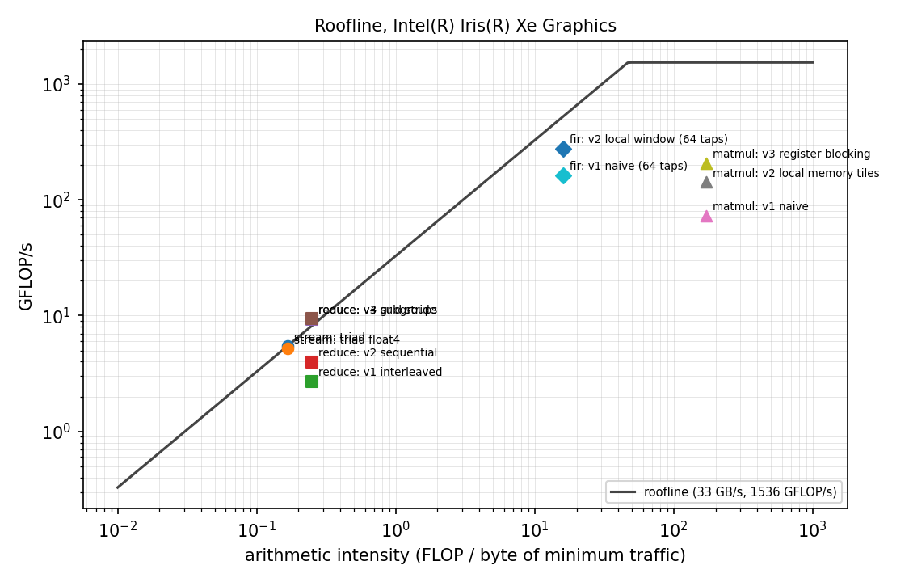

# GPU kernel profiler

A small developer tool for learning and showing how GPU kernels get fast. Four workloads are written as
OpenCL C kernels in progressively optimised versions; the tool times every version on the device with
profiling events, checks it against NumPy, computes bandwidth, GFLOP/s and arithmetic intensity, and places
it on a roofline built from the device's peak and the measured memory bandwidth.

All numbers below were measured on an **Intel Iris Xe** integrated GPU (80 execution units at 1.2 GHz,
64 KB shared local memory, 1536 GFLOP/s FP32 peak) in a laptop with a Core i5-1235U.



## What each optimisation does, and what it bought

| Workload | Version | Time | Throughput | Speedup | What changed |
|---|---|---|---|---|---|
| Reduction, 16.8 M floats | v1 interleaved | 6.19 ms | 10.8 GB/s | 1.0x | tree in local memory, modulo test: divergent subgroups, bank conflicts |
| | v2 sequential | 4.20 ms | 16.0 GB/s | 1.5x | contiguous active work items, so whole subgroups retire together |
| | v3 grid stride | 2.33 ms | 28.8 GB/s | 2.7x | each work item sums many elements first; far fewer groups and barriers |
| | v4 subgroups | 2.38 ms | 28.2 GB/s | 2.6x | `sub_group_reduce_add` in registers instead of the local memory tree |
| | NumPy on CPU | 11.78 ms | 5.7 GB/s | | |
| Matrix multiply, 1024 x 1024 | v1 naive | 29.7 ms | 72 GFLOP/s | 1.0x | every operand from global memory |
| | v2 local memory tiles | 15.1 ms | 142 GFLOP/s | 2.0x | 16 x 16 tiles staged in shared local memory |
| | v3 register blocking | 10.4 ms | 207 GFLOP/s | 2.9x | each work item computes 4 outputs, reusing loads from registers |
| | NumPy on CPU (BLAS) | 8.0 ms | 269 GFLOP/s | | |
| FIR filter, 64 taps, 4.2 M samples | v1 naive | 3.28 ms | 164 GFLOP/s | 1.0x | every tap reads global memory |
| | v2 local window | 1.97 ms | 273 GFLOP/s | 1.7x | the group loads its input window once into local memory |
| | NumPy on CPU | 58.6 ms | 9 GFLOP/s | | |

Measured memory bandwidth (STREAM triad): about **31 to 33 GB/s**, shared with the CPU. Full table with % of
the roofline and correctness of every run: [results/REPORT.md](results/REPORT.md).

## What the numbers say

* **Reduction is memory bound** (0.25 FLOP/byte, far left of the ridge point at about 47 FLOP/byte). Once
  v3 reaches about 90% of measured bandwidth, the subgroup version cannot be faster; it only removes
  barriers. The right question for a memory bound kernel is "how close to bandwidth", not "how many FLOPs".
* **Matrix multiply is compute bound** and still only at about 13% of peak. Tiling and register blocking
  give 2.9x, but an optimised CPU BLAS is still faster. The next steps would be larger register tiles,
  vector loads, and Intel subgroup block reads, which is where vendor libraries (oneMKL) get their speed.
* **FIR filtering** sits in between (16 FLOP/byte). Sharing the input window in local memory gives 1.7x
  and makes the GPU about 30 times faster than NumPy's `correlate` on the CPU.

## Run it

```bash
python -m venv .venv && .venv/bin/pip install -e ".[dev]"
python -m gkp info                 # selected device and its peak numbers
python -m gkp run                  # all suites, writes results/REPORT.md, results.json and roofline.png
python -m gkp run --suite matmul --quick
GKP_DEVICE=cpu python -m gkp run   # choose a device by name
pytest -q                          # every kernel variant against NumPy
```

No GPU? `pip install -e ".[cpu]"` installs PoCL, which runs the same kernels on the CPU. CI uses it to check
correctness of every variant on each push.

## Layout

```
gkp/kernels/*.cl   OpenCL C kernels: stream, reduce (4 versions), matmul (3), fir (2)
gkp/runtime.py     device selection, build options, event based timing (median of repeats)
gkp/suites.py      each workload: inputs, launch sizes, NumPy reference, bytes and FLOPs
gkp/report.py      markdown table and roofline plot
tests/             correctness of every variant, metrics and report generation
```
